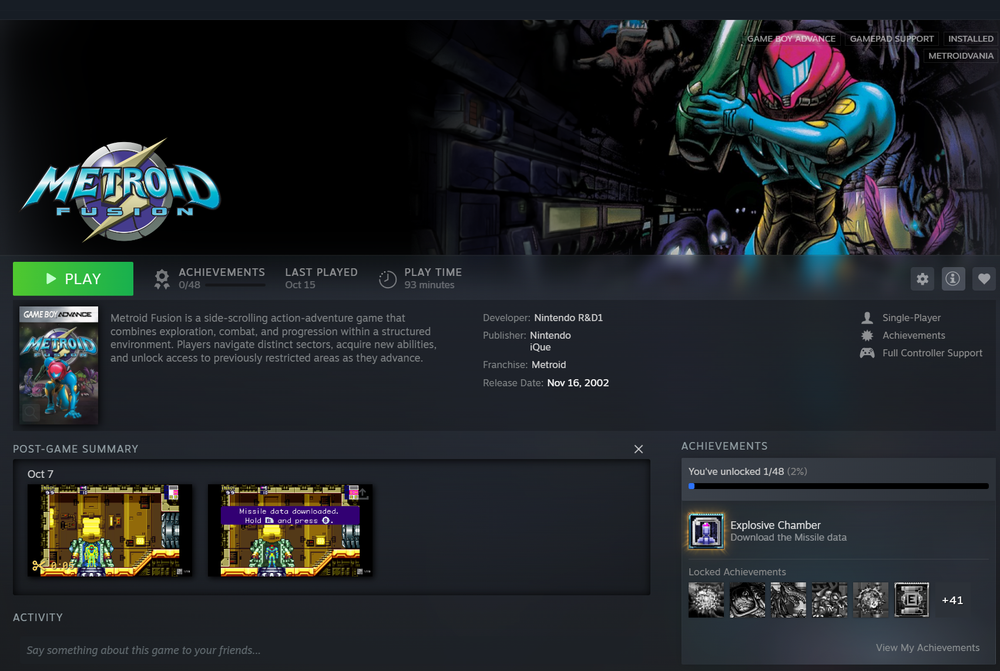

# Steam Cartridges

A [Millennium](https://steambrew.app) plugin that makes non-Steam games feel like native Steam games.

If you use Steam as a gaming-console style hub (living in Big Picture, with your emulators, PC games and launchers all
in one library), a non-Steam game normally looks like a second-class citizen: a bare page with a grey "information is
unavailable" box. Steam Cartridges gives every non-Steam game the same rich app page a Steam game has, using Steam's
own components, on the desktop **and** in Big Picture.

> **Beta.** Steam Cartridges is in public beta (0.1.0-beta). It is tested on my own library, not yours: expect rough
> edges and please report what you find in an [issue](../../issues) with the Steam log lines (`logs/`) around it.

## Features

- **Steam's own app page for any non-Steam game:** hero and capsule art, the Play bar with last played and play time,
  the Game Info tab (description, developer, publisher, franchise, release date, category badges), and the
  Post-Game Summary and Recordings and Screenshots built from the captures Steam already took.
- **Game Info from the best source available:** a Steam Store match first, then IGDB or ScreenScraper, and your own
  edits always win. Edit any game by hand with Manual Edit.
- **Artwork:** a Steam match brings the native portrait, hero, logo and wide art; games without one get artwork and a
  proper library icon from SteamGridDB.
- **Achievements for non-Steam games:** RetroAchievements for ROMs (hashed locally, no extra tools), RPCS3 and shadPS4
  trophies, the Bloodborne PC port's trophies (with their icons from your own dump), and the emulator logs it recognises. They show in Steam's own achievements page, with Steam's own unlock
  toasts and progress bars. What each source needs: [Achievements.md](Achievements.md).
- **Community tab content:** trailers, artwork and game manuals (with a ScreenScraper account) as cards in the
  Community section.
- **Nothing is rebuilt:** the plugin restores the sections Steam hides from shortcuts and feeds Steam's own stores, so
  it looks, navigates and feels like the real thing, controller included.

[](.github/example.png)

## Install

Requires [Millennium](https://steambrew.app).

1. Download `steam-cartridges-<version>.zip` from the [latest release](../../releases).
2. Extract it into `<Steam>/millennium/plugins/`, so the plugin is in `<Steam>/millennium/plugins/steam-cartridges`.
3. Restart Steam and enable **Steam Cartridges** in the Millennium settings.

To update, replace that folder with the new release's. Your settings and data are kept (they live in Steam's
`millennium/config` folder, not in the plugin's).

<details>
<summary>Build from source instead</summary>

Node.js 20+:

```bash
npm install
npm run build
```

Then copy the folder (with the generated `.millennium` folder inside it) to `<Steam>/millennium/plugins/steam-cartridges`.

</details>

## Setup

It works on its own with no setup: install it and your non-Steam games get Steam's page and Post-Game Summary from the
captures Steam already has. The rest is in Steam's Millennium settings under **Steam Cartridges**:

- **Metadata:** add your IGDB (Twitch), SteamGridDB or ScreenScraper credentials with **Add service**. Game Info and
  artwork from the web need at least one of them.
- **Auto Mode (on by default):** every non-Steam game is looked up automatically, by what its shortcut runs:
  - **Emulators and ROMs** (RetroArch, DuckStation, PCSX2, ...): Game Info from IGDB, then ScreenScraper.
  - **PC games:** a match to the same game on Steam first (Steam's own Game Info and artwork), else IGDB.
- **Your own rules** (Routing Rules → **Custom Rules**) take over from Auto Mode: include or exclude games from a
  service (Steam Store Mirror, IGDB, ScreenScraper, SteamGridDB, RetroAchievements, Console Emulators) by **collection**,
  **game title** or a **regex pattern**. With **Auto Mode** off, every service may be used for every game unless a
  rule excludes it.
- **Manual Edit** (Library Analytics): every game full screen. **Only games with issues** lists the games missing
  Game Info, controller support or achievements, with what they miss tinted red; fill it in, link the right Steam, IGDB
  ScreenScraper or RetroAchievements entry, mark a game as having **No achievements**, or **Ignore issues**. Your own Game Info for a
  game always wins.

**Your artwork stays yours.** A portrait, hero, logo, wide capsule or icon you set yourself in Steam is never replaced:
Steam Cartridges only fills the empty ones (and replaces only art it put there itself).

Achievements and what each source needs: [Achievements.md](Achievements.md).

For your screenshots and recordings as "{Username} captured" cards in the Activity feed, install
[Steam Captured Activity](https://github.com/gunCannoli/steam-captured-activity) next to it.

## Notes

- **Your art is replaced for Steam Store matches:** a match sets the native portrait, hero, logo and wide art on the
  shortcut, replacing art you set in those slots. **Clear** in the settings removes the match and only the art this
  plugin wrote, and remembers the rejection.
- **Requests are rare and polite:** web requests only happen for games in the Steam Store and Web Scraping buckets, at
  most one per second, and downloaded media stays on disk (the "Keep downloaded media" setting).
- **Your data stays local:** the plugin stores its records (Game Info, matches, credentials) in
  `millennium/config/steam-cartridges` inside your Steam folder; nothing is sent anywhere except the lookups above.

## Reporting a problem

Send the log file: `<your Steam folder>\millennium\config\steam-cartridges\steam-cartridges.log`.
It lists what the plugin did and what each service (IGDB, ScreenScraper, RetroAchievements, SteamGridDB) answered.
Passwords, keys, tokens and your Windows user name are removed before anything is written.

## Support

If this plugin is useful to you, you can support its development on [Ko-fi](https://ko-fi.com/cannoligun).

## About

Makes non-Steam games feel native: Steam's own app page from your captures, plus optional metadata, artwork and
achievements.

## License

MIT
